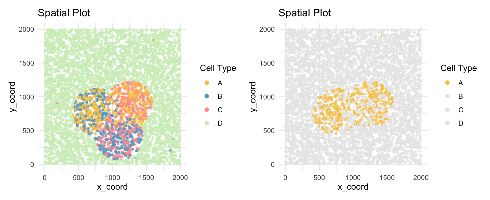
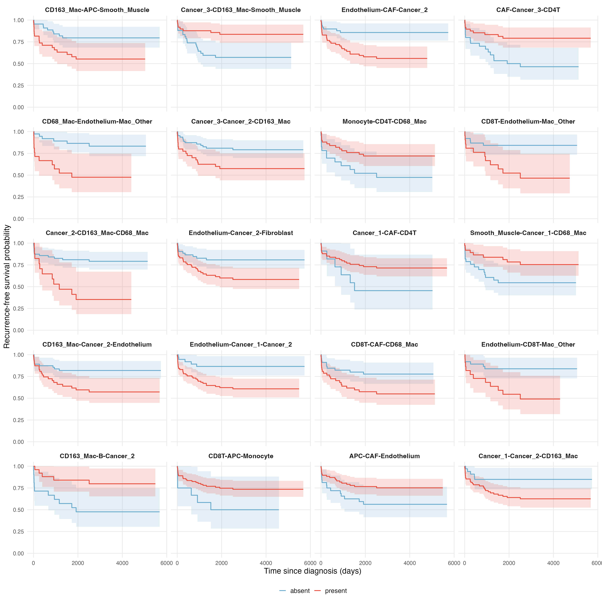

# **MANGO**
<p align="center"><strong>MANGO (MAppiNG multi-cell-type multi-scale spatial relationships in spatially resolved Omics)</strong></p>

MANGO is a permutation-based computational framework for detecting higher-order spatial co-localization across multiple spatial scales.

MANGO defines the local microenvironment of each reference cell using a k-nearest-neighbor neighborhood with Gaussian distance-decay weighting. Within each neighborhood, MANGO computes a multivariate local co-localization quotient (mLCLQ) that quantifies whether a predefined set of query cell types co-occurs more frequently than expected given their global spatial distributions. Significance is assessed through permutation testing. MANGO is implemented as an open-source R package, available at: https://github.com/ZihanYang030/mango. 

<p align="center">
  
</p>

Schematic of mLCLQ calculation 

For each reference cell, we compute local weighted proportions of the query types within neighborhoods using spatial weights and observed cell-type labels. The proportions are combined and divided by the global cell-type abundance to obtain an observed mLCLQ score. We then repeat the calculation with independently permuted labels produces null scores.

<p align="center">
  
</p>

MANGO is under active development. We appreciate any suggestions and feedback. Contact: [zy56@rice.edu](mailto:zy56@rice.edu). 

## Install the Package
Install MANGO from GitHub:
```r
remotes::install_github("ZihanYang030/MANGO")
library(MANGO)
```

## Quick Start

**Table of Content**
- [Simulation](#simulation) - Simple Demonstrations
- [Needs Statement](#why-mango) - **Why MANGO?**
- [Triple-Negative Breast Cancer](#triple-negative-breast-cancer) - Cohort-Level Analysis
- [Mouse Brain Thick Slice](#mouse-brain-thick-slice) - Extension to 3D Data
- [Alzheimer Mouse Brain](#alzheimer-mouse-brain) - Collocations with Pathological Protein Markers

### Simulation

Let's start from the basic - idealized simulation data

**Visualization**

Visualize a simulated section.
```r
library(MANGO)
library(patchwork)

# generate simulation data
sim <- generate_alternative_circle_simulation(num_cells = 5000, circle_radius = 350, circle_distances = 300)

# build SingleCellExperiment object
sim_sce <- build_sce(sim)

p1 <- Plot_Basic(sim_sce, type_column = "cell_type", coords = c("x_coord", "y_coord"), point_size = 1)
p2 <- Plot_Basic(sim_sce, type_column = "cell_type", highlight_celltypes = "A", coords = c("x_coord", "y_coord"), point_size = 1)

p1 + p2
```
<p align="center">
  
</p>

**Build Neighborhoods**

Here, we show an example knn neighborhoods built with k = 35, three weight kernels available.

Neighborhood is created around each type A cell. 

```r
occurr_prob <- calculate_occurrence_probability_multi_image(sim_sce, type_column = "cell_type", image_column = "image_number")

# gaussian weight
weight_g <- compute_spatial_weights_multi_image(sim_sce, type_column = "cell_type",
                                               type_column = "cell_type", point_type = "A", 
                                               image_column = "image_number", method = "k_nearest", 
                                               k = 35, coords = c("x_coord", "y_coord"), kernel = "gaussian")

# we also have matern and exponential weights available
weight_m <- compute_spatial_weights_multi_image(sim_sce, type_column = "cell_type",
                                               type_column = "cell_type", point_type = "A", 
                                               image_column = "image_number", method = "k_nearest", 
                                               k = 35, coords = c("x_coord", "y_coord"), kernel = "matern")

weight_e <- compute_spatial_weights_multi_image(sim_sce, type_column = "cell_type",
                                                type_column = "cell_type", point_type = "A", 
                                                image_column = "image_number", method = "k_nearest", 
                                                k = 35, coords = c("x_coord", "y_coord"), kernel = "exponential")
```

Visualize a neighborhood with three available weight kernels.

```r
p_g <- Plot_Stored_Neighborhood(sim_sce, weight_g, type_column = "cell_type", reference_cell = "3329", 
                                coords = c("x_coord", "y_coord"), neighbor_color_by = "weight",
                                zoom = TRUE, title = "Gaussian Weight")
  
p_m <- Plot_Stored_Neighborhood(sim_sce, weight_m, type_column = "cell_type", reference_cell = "3329", 
                                coords = c("x_coord", "y_coord"), neighbor_color_by = "weight",
                                zoom = TRUE, title = "Matern Weight")
  
p_e <- Plot_Stored_Neighborhood(sim_sce, weight_e, type_column = "cell_type", reference_cell = "3329", 
                                coords = c("x_coord", "y_coord"), neighbor_color_by = "weight",
                                zoom = TRUE, title = "Exponential Weight")
  
p_g + p_m + p_e
```

<p align="center">
  
</p>

**Calculate observed mLCLQ score & Multi-Scale Permutation**

Using Gaussian weight kernel as default, we then calculate the observed mLCLQ scores and perform permutation

Here, we are interested in the spatial aggregations between A, B, and C cells (i.e. Do B and C cells aggregate around A cells?) \
Setting A as the reference cell type, B and C as the query cell types, we compute observed mLCLQ scores for the references and perform multi-scale permutation testing. 

```r
# calcualte observed mLCLQ scores
obs_mLCLQ <- calculate_mvlclq_multi_image(
  sim_sce, weight_g, type_column = "cell_type", point_type = "A", 
  target_types = c("B", "C"), occurrence_probs = occurr_prob,
  image_column = "image_number")

# perform permutation, calculated SES scores from observed and permuted mLCLQ scores
sim_mLCLQ <- simulate_multiscale_mvlclq_fast_downsample(
  sim_sce, weight_g, type_column = "cell_type", 
  point_type = "A", target_types = c("B", "C"),
  obs_mLCLQ, occurr_prob, image_column = "image_number",
  scales = c(50, 250, 500, 750, 1000, 1250, 1500, 1750, 2000),
  coord_names = c("x_coord", "y_coord"))
```
Multi-scale permutation is performed by constructing permutation squares with different side lengths using each reference cell as the centric. 
<p align="center">
  
</p>
Permutation Results:

```r
ses_panel(sim_sce, sim_mLCLQ,
          reference = "A", queries = c("B", "C"),
          type_column = "cell_type",
          coords = c("x_coord", "y_coord"),
          scale = 2000, image_name = "1")
```
We visualize the mean SES score for each interaction across multiple permutation scales as well as single-cell-level SES scores

<p align="center">
  
</p>

The trendline plot shows a summary of each interaction across different scales; the SES score spatial map shows where each aggregation is observed: high SES scores (yellow) represent aggregations, low SES scores (blue) represent repulsions. \
We benchmarked MANGO's power and false discovery rate against pairwise methods across 273 simulation cases (100 replicates each), and assessed its sensitivity to 7 background proportions and 3 neighborhood sizes (k).

Apparently, in this simulated section, both the triple-cell-type aggregation and its constituent pairwise aggregations are present

<a id="why-mango"></a>
### Then why is there a need for MANGO? How is it different from pairwise methods?

In biological tissue structures: 

a) cellular neighborhoods are frequently composed of multiple interacting cell types, such as tertiary lymphoid structures, immunosuppressive neighborhoods, alveolar parenchyma, etc. 
- there is a need for multi-cell-type aggregation identification 

b) in noisy experimental datasets, constituent pairwise aggregations do not always co-occur with higher-order multi-cell-type aggregations
- there is a need for a **direct** multi-cell-type aggregation identification, instead of inferring multi-cell-type aggregations from pairwise aggregations

### Triple-Negative Breast Cancer

**Single FOV Analysis**

```r
# read in data
stanford_preprocessed <- readH5AD("/File/Path/to/stanford_preprocessed.h5ad")

# extract coordinates
spatial_coords <- stanford_preprocessed@int_colData@listData[["reducedDims"]]@listData[["spatial"]]

x_coordinate <- spatial_coords[, "centroid-0"]
y_coordinate <- spatial_coords[, "centroid-1"]

colData(stanford_preprocessed)$x_coordinate <- x_coordinate
colData(stanford_preprocessed)$y_coordinate <- y_coordinate

stanford_preprocessed_individual_image <- stanford_preprocessed[, stanford_preprocessed$fov == "TMA30S1_R2C7"]

# visualizations
plot1 <- Plot_Basic(stanford_preprocessed_individual_image, 
                   type_column = "cell_cluster",
                   highlight_celltypes = NULL,
                   coords = c("x_coordinate", "y_coordinate"),
                   title = NULL,
                   point_size = 2)

plot2 <- Plot_Basic(stanford_preprocessed_individual_image, 
                    type_column = "cell_cluster",
                    highlight_celltypes = c("B", "CD4T", "CD8T"),
                    coords = c("x_coordinate", "y_coordinate"),
                    title = NULL,
                    point_size = 2)

(plot1 + plot2)
```

<p align="center">
  
</p>

```r
# mango analysis pipeline

occurr_prob_TMA30S1_R2C7 <- calculate_occurrence_probability_multi_image(stanford_preprocessed_individual_image, 
                                                                         type_column = "cell_cluster", 
                                                                         image_column = "fov")

weights_data_TMA30S1_R2C7 <- compute_spatial_weights_multi_image(stanford_preprocessed_individual_image, 
                                                                 type_column = "cell_cluster", 
                                                                 point_type = "B",
                                                                 image_column = "fov", 
                                                                 method = "k_nearest", 
                                                                 k = 15,
                                                                 coords = c("x_coordinate", "y_coordinate"), 
                                                                 exclude_ref_as_neighbor = TRUE)

observed_mvlclq_TMA30S1_R2C7 <- calculate_mvlclq_multi_image(stanford_preprocessed_individual_image, 
                                                             weights_data_TMA30S1_R2C7,
                                                             type_column = "cell_cluster", 
                                                             point_type = "B", 
                                                             target_types = c("CD4T", "CD8T"),
                                                             capped = TRUE, 
                                                             capped_query_num = 2, 
                                                             occurr_prob_TMA30S1_R2C7)

sim_results_TMA30S1_R2C7 <- simulate_multiscale_mvlclq_fast_downsample(stanford_preprocessed_individual_image, 
                                                                       weights_data_TMA30S1_R2C7, 
                                                                       type_column = "cell_cluster",
                                                                       point_type = "B", 
                                                                       target_types = c("CD4T", "CD8T"), 
                                                                       observed_mvlclq_TMA30S1_R2C7,
                                                                       occurr_prob_TMA30S1_R2C7, 
                                                                       image_column = "fov",
                                                                       scales = c(50, 250, 500, 1000, 1500, 1750),
                                                                       coord_names = c("x_coordinate", "y_coordinate"), 
                                                                       simulation_times = 999)


ses_panel(stanford_preprocessed_individual_image, sim_results_TMA30S1_R2C7,
          reference = "B", queries = c("CD4T", "CD8T"),
          type_column = "cell_cluster",
          coords = c("x_coordinate", "y_coordinate"),
          scale = 1750, image_name = "TMA30S1_R2C7")
```

<p align="center">
  
</p>

At the cohort level, MANGO identified conserved spatial patterns across tissue sections (B-CD4T-CD8T). Although the triple-cell-type lymphocyte aggregations are commonly observed, their constitutive pairwise interactions are frequently absent, indicating the need for a **direct** triple-cell-type aggregation identification.

<p align="center">
  
</p>

MANGO identified triple-cell-type aggregations are associate with statistically significant patient outcomes. 

<p align="center">
  
</p>

Survival plots panel:

<p align="center">
  
</p>

Analyses use the Stanford triple-negative breast cancer cohort (MIBI-TOF spatial
proteomics) from Ranek et al. (2026). Raw images and cell segmentation masks are
available from the BioStudies BioImage Archive under accession
[S-BIAD1507](https://www.ebi.ac.uk/biostudies/bioimages/studies/S-BIAD1507).

### Mouse Brain Thick Slice

MANGO is compatible for 3-dimensional datasets.

In 3D datasets, instead of permutation squares, MANGO constructs permutation cubes using each reference cell as the centroid. 

<p align="center">
  
</p>

### Alzheimer Mouse Brain

To be updated

## License
MANGO is licensed under the GNU General Public License v3.0 or any later version.

## References

Ranek, J. S., Greenwald, N. F., Goldston, M., Fullaway, C. C., Sowers, C., Kong, A., Mouron, S., Quintela-Fandino, M., West, R. B. & Angelo, M. The automated computational workflow QUICHE reveals structural definitions of antitumor responses in triple-negative breast cancer. *Nature Cancer* **7**, 451–468 (2026). https://doi.org/10.1038/s43018-026-01122-5


