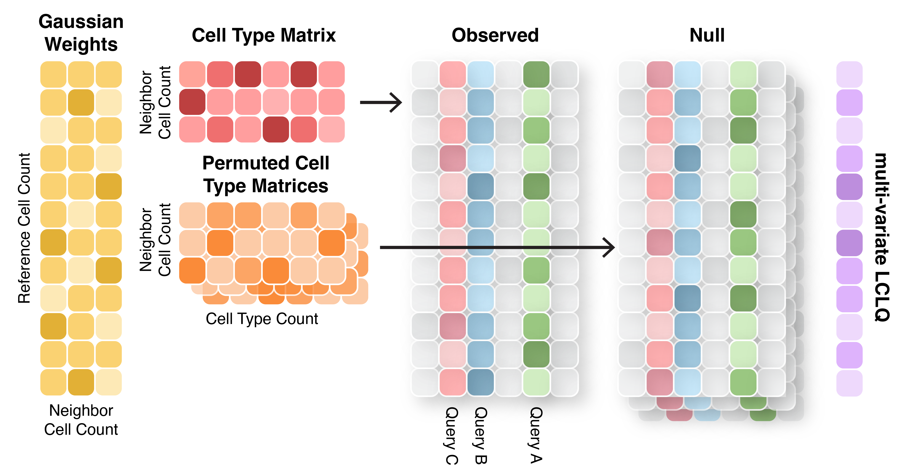
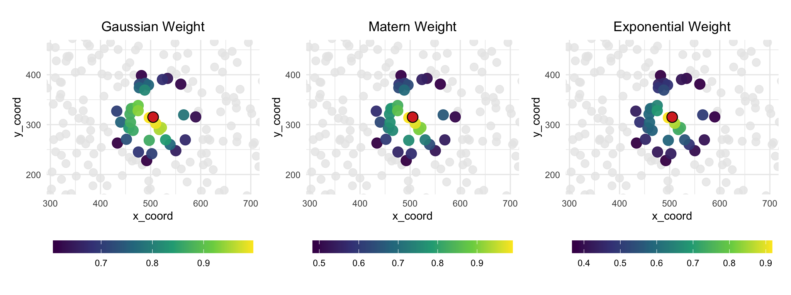

# **MANGO**
<p align="center"><strong>MANGO (MAppiNG multi-cell-type multi-scale spatial relationships in spatially resolved Omics)</strong></p>

MANGO is a permutation-based computational framework for detecting higher-order spatial co-localization across multiple spatial scales.

MANGO defines the local microenvironment of each reference cell using a k-nearest-neighbor neighborhood with Gaussian distance-decay weighting. Within each neighborhood, MANGO computes a multivariate local co-localization quotient (mLCLQ) that quantifies whether a predefined set of query cell types co-occurs more frequently than expected given their global spatial distributions. Significance is assessed through permutation testing. MANGO is implemented as an open-source R package, available at: https://github.com/ZihanYang030/mango. 

<p align="center">
  
</p>

Schematic of mLCLQ calculation 

For each reference cell, we compute local weighted proportions of the query types within neighborhoods using spatial weights and observed cell-type labels. The proportions are combined and divided by the global cell-type abundance to obtain an observed mLCLQ score. We then repeat the calculation with independently permuted labels produces null scores.

<p align="center">
  
</p>

MANGO is under active development. We appreciate any suggestions and feedback. Contact: [zy56@rice.edu](mailto:zy56@rice.edu). 

## Install the Package
Install MANGO from GitHub:
```r
remotes::install_github("ZihanYang030/MANGO")
library(MANGO)
```

## Quick Start

### Visualization

Visualize a simulated section.
```r
library(MANGO)
library(patchwork)

# generate simulation data
sim <- generate_alternative_circle_simulation(num_cells = 5000, circle_radius = 350, circle_distances = 300)

# build SingleCellExperiment object
sim_sce <- build_sce(sim)

p1 <- Plot_Basic(sim_sce, type_column = "cell_type", coords = c("x_coord", "y_coord"), point_size = 1)
p2 <- Plot_Basic(sim_sce, type_column = "cell_type", highlight_celltypes = "A", coords = c("x_coord", "y_coord"), point_size = 1)

p1 + p2
```
<p align="center">
  
</p>

### Build Neighborhoods

Here, we show an example knn neighborhoods built with k = 35, three weight kernels available.

Neighborhood is created around each type A cell. 

```r
occurr_prob <- calculate_occurrence_probability_multi_image(sim_sce, type_column = "cell_type", image_column = "image_number")

# gaussian weight
weight_g <- compute_spatial_weights_multi_image(sim_sce, type_column = "cell_type",
                                               type_column = "cell_type", point_type = "A", 
                                               image_column = "image_number", method = "k_nearest", 
                                               k = 35, coords = c("x_coord", "y_coord"), kernel = "gaussian")

# we also have matern and exponential weights available
weight_m <- compute_spatial_weights_multi_image(sim_sce, type_column = "cell_type",
                                               type_column = "cell_type", point_type = "A", 
                                               image_column = "image_number", method = "k_nearest", 
                                               k = 35, coords = c("x_coord", "y_coord"), kernel = "matern")

weight_e <- compute_spatial_weights_multi_image(sim_sce, type_column = "cell_type",
                                                type_column = "cell_type", point_type = "A", 
                                                image_column = "image_number", method = "k_nearest", 
                                                k = 35, coords = c("x_coord", "y_coord"), kernel = "exponential")
```

Visualize a neighborhood with three available weight kernels.

```r
p_g <- Plot_Stored_Neighborhood(sim_sce, weight_g, type_column = "cell_type", reference_cell = "3329", 
                                coords = c("x_coord", "y_coord"), neighbor_color_by = "weight",
                                zoom = TRUE, title = "Gaussian Weight")
  
p_m <- Plot_Stored_Neighborhood(sim_sce, weight_m, type_column = "cell_type", reference_cell = "3329", 
                                coords = c("x_coord", "y_coord"), neighbor_color_by = "weight",
                                zoom = TRUE, title = "Matern Weight")
  
p_e <- Plot_Stored_Neighborhood(sim_sce, weight_e, type_column = "cell_type", reference_cell = "3329", 
                                coords = c("x_coord", "y_coord"), neighbor_color_by = "weight",
                                zoom = TRUE, title = "Exponential Weight")
  
p_g + p_m + p_e
```

<p align="center">
  
</p>

## Calculate observed mLCLQ score & Multi-Scale Permutation

Using Gaussian weight kernel as default, we then calculate the observed mLCLQ scores and perform permutation

Here, we are interested in the spatial aggregations between A, B, and C cells (i.e. Do B and C cells aggregate around A cells?)

```r
# calcualte observed mLCLQ scores
obs_mLCLQ <- calculate_mvlclq_multi_image(
  sim_sce, weight_g, type_column = "cell_type", point_type = "A", 
  target_types = c("B", "C"), occurrence_probs = occurr_prob,
  image_column = "image_number")

# perform permutation, calculated SES scores from observed and permuted mLCLQ scores
sim_mLCLQ <- simulate_multiscale_mvlclq_fast_downsample(
  sim_sce, weight_g, type_column = "cell_type", 
  point_type = "A", target_types = c("B", "C"),
  obs_mLCLQ, occurr_prob, image_column = "image_number",
  scales = c(50, 250, 500, 750, 1000, 1250, 1500, 1750, 2000),
  coord_names = c("x_coord", "y_coord"))
  
# visualizations
trendline_plot <- plot_reference_query_interactions_multi_image_mean(
  sim_mLCLQ, sim_sce, type_column = "cell_type", image = "1")

# visualize pairwise A-B aggregation SES scores
heatmap_B <- Scatter_Heatmap(
  sim_sce, type_column = "cell_type", sim_mLCLQ, 
  coords = c("x_coord", "y_coord"), scale = 2000, image_name = "1", 
  query_celltype = "B", reference_celltype = "A", title = "A-B SES Score", point_size = 1)

# visualize pairwise A-C aggregation SES scores
heatmap_C <- Scatter_Heatmap(
  sim_sce, type_column = "cell_type", sim_mLCLQ, 
  coords = c("x_coord", "y_coord"), scale = 2000, image_name = "1", 
  query_celltype = "C", reference_celltype = "A", title = "A-C SES Score", point_size = 1)

# visualize triple A-B-C aggregation SES scores
heatmap_BC <- Scatter_Heatmap(
  sim_sce, type_column = "cell_type", sim_mLCLQ, 
  coords = c("x_coord", "y_coord"), scale = 2000, image_name = "1", 
  query_celltype = "B_C", reference_celltype = "A", title = "A-B-C SES Score", point_size = 1)

no_axes <- theme(axis.title = element_blank(), axis.text = element_blank(),
                 axis.ticks = element_blank(), panel.grid = element_blank())

trendline_plot | ((heatmap_B | heatmap_C) / (heatmap_BC | p1)) & no_axes
```
We visualize the mean SES score for each interaction across multiple permutation scales as well as single-cell-level SES scores

<p align="center">
  
</p>

The trendline plot shows a summary of each interaction across different scales, the SES score spatial map shows where each aggregation is observed

## License
MANGO is licensed under the GNU General Public License v3.0 or any later version.
