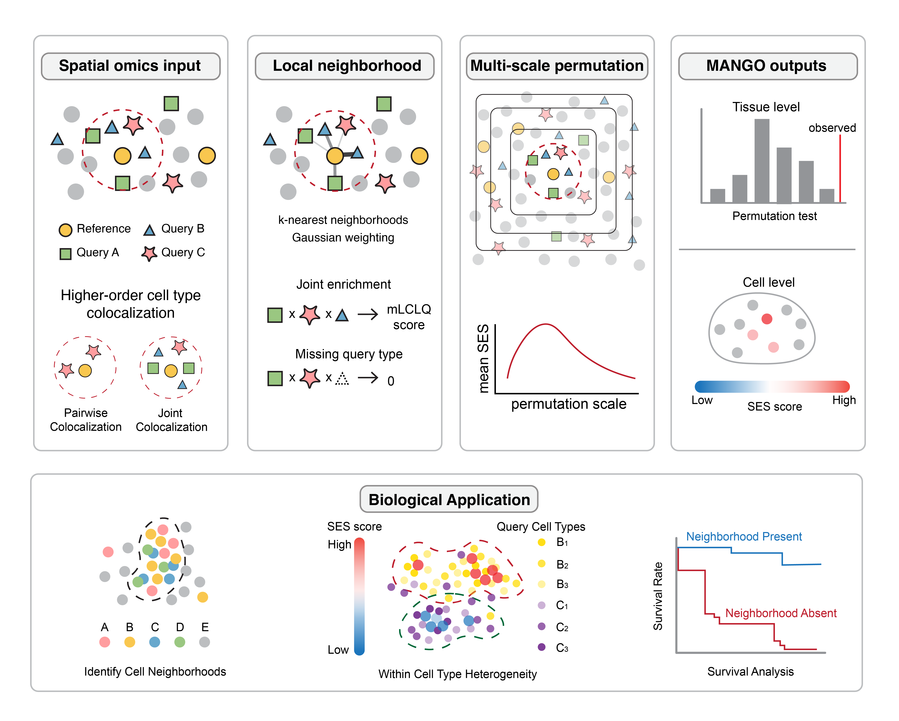
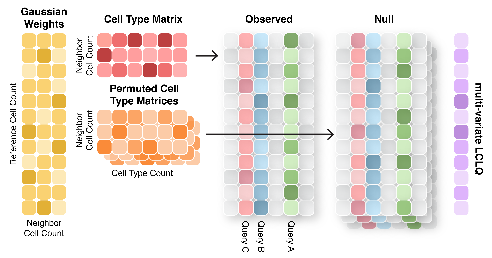

# **MANGO**
<p align="center"><strong>MANGO (MAppiNG multi-cell-type multi-scale spatial relationships in spatially resolved Omics)</strong></p>

MANGO is a permutation-based computational framework for detecting higher-order spatial co-localization across multiple spatial scales.

MANGO defines the local microenvironment of each reference cell using a k-nearest-neighbor neighborhood with Gaussian distance-decay weighting. Within each neighborhood, MANGO computes a multivariate local co-localization quotient (mLCLQ) that quantifies whether a predefined set of query cell types co-occurs more frequently than expected given their global spatial distributions. Significance is assessed through permutation testing. MANGO is implemented as an open-source R package, available at: https://github.com/ZihanYang030/mango. 

<p align="center">
  
</p>

Schematic of mLCLQ calculation 

For each reference cell, we compute local weighted proportions of the query types within neighborhoods using spatial weights and observed cell-type labels. The proportions are combined and divided by the global cell-type abundance to obtain an observed mLCLQ score. We then repeat the calculation with independently permuted labels produces null scores.

<p align="center">
  
</p>

MANGO is under active development. We appreciate any suggestions and feedback. Contact: [zy56@rice.edu](mailto:zy56@rice.edu). 

## Install the Package
Install MANGO from GitHub:
```r
remotes::install_github("ZihanYang030/MANGO")
library(MANGO)
```

## License
MANGO is licensed under the GNU General Public License v3.0 or any later version.
