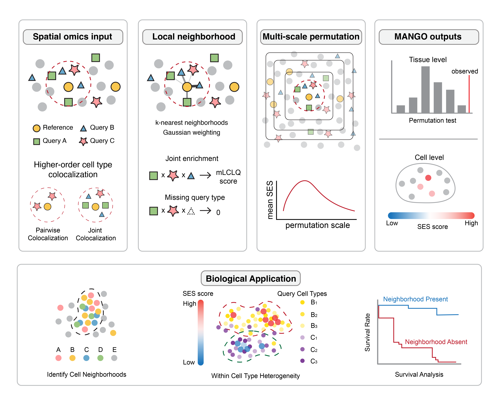
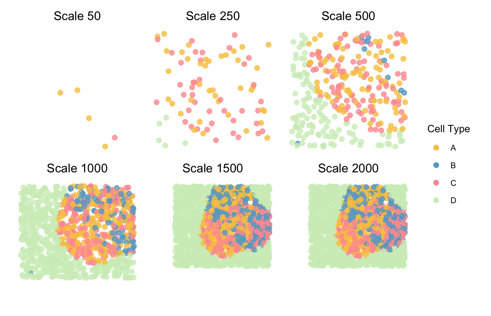
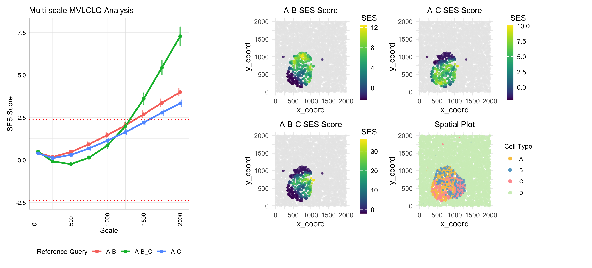
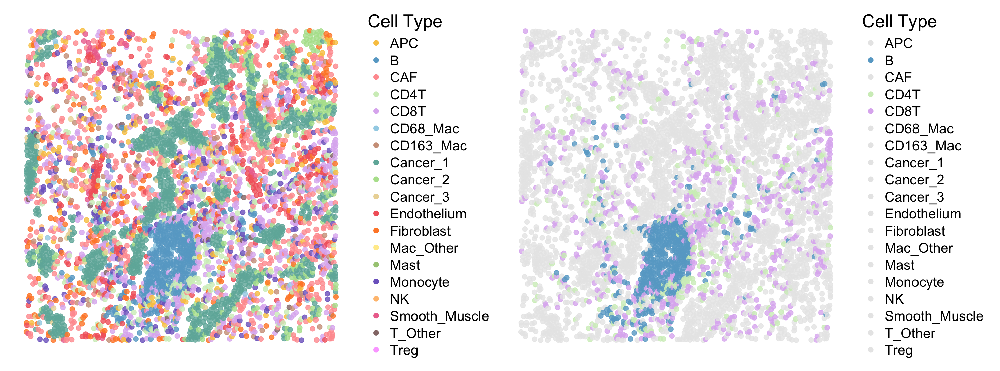
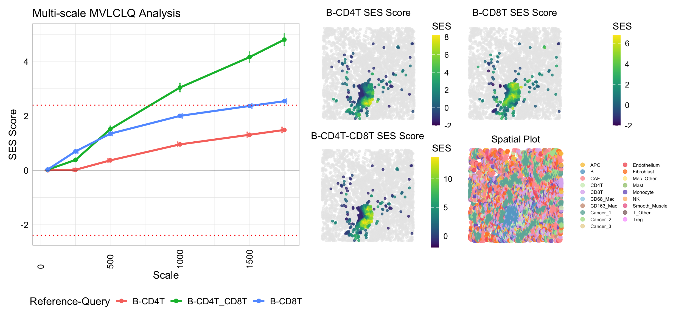
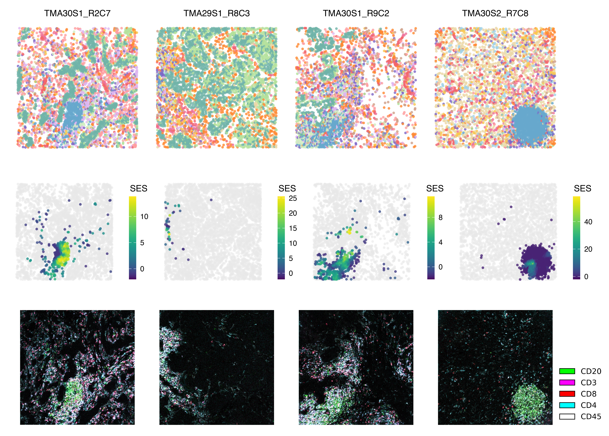
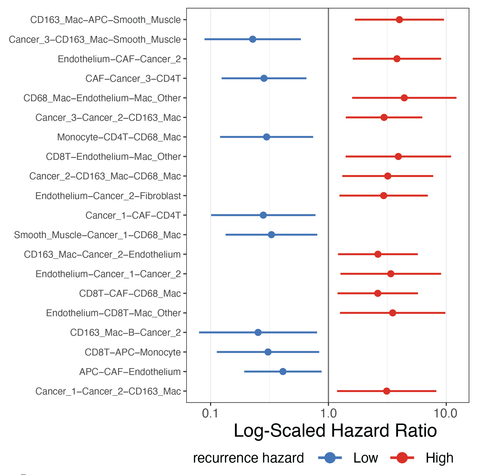
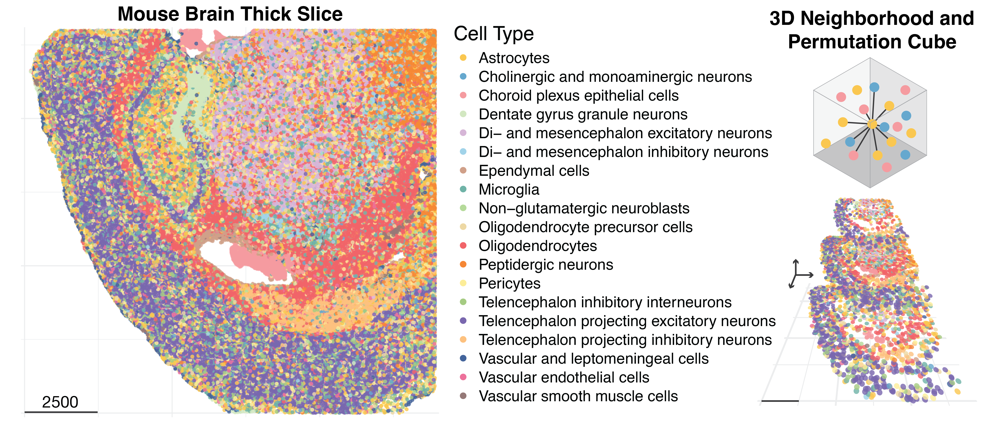
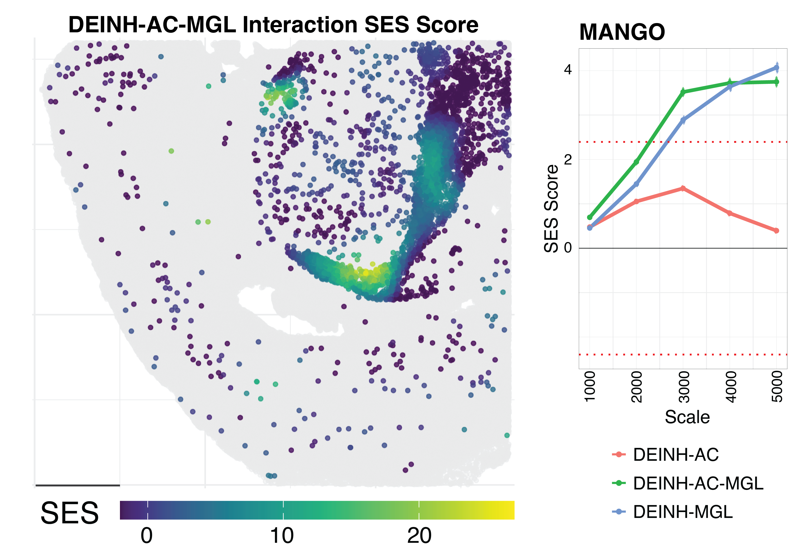
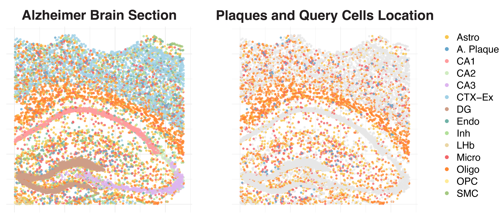

# **MANGO**
<p align="center"><strong>MANGO (MAppiNG multi-cell-type multi-scale spatial relationships in spatially resolved Omics)</strong></p>

MANGO is a permutation-based computational framework for detecting higher-order spatial co-localization across multiple spatial scales.

MANGO defines the local microenvironment of each reference cell using a k-nearest-neighbor neighborhood with Gaussian distance-decay weighting. Within each neighborhood, MANGO computes a multivariate local co-localization quotient (mLCLQ) that quantifies whether a predefined set of query cell types co-occurs more frequently than expected given their global spatial distributions. Significance is assessed through permutation testing. MANGO is implemented as an open-source R package, available at: https://github.com/ZihanYang030/mango. 

<p align="center">
  
</p>

Schematic of mLCLQ calculation 

For each reference cell, we compute local weighted proportions of the query types within neighborhoods using spatial weights and observed cell-type labels. The proportions are combined and divided by the global cell-type abundance to obtain an observed mLCLQ score. We then repeat the calculation with independently permuted labels to produce null scores. Using observed and null mLCLQ scores, we compute standardized effect size (SES) and tissue-section-level p-value to determine statistical significance. 

<p align="center">
  
</p>

**How to read mLCLQ**

For the chosen query cell types, an observed mLCLQ score is computed for each reference cell. The score quantifies how strongly these query types co-occur in reference cells' neighborhoods. 

MANGO is under active development. We appreciate any suggestions and feedback. Contact: [zy56@rice.edu](mailto:zy56@rice.edu). 

## Install the Package
Install MANGO from GitHub:
```r
remotes::install_github("ZihanYang030/MANGO")
library(MANGO)
```

## Quick Start

**Table of Content**
- [Simulation](#simulation) - Simple Demonstrations
- [Needs Statement](#why-mango) - **Why MANGO?**
- [Triple-Negative Breast Cancer](#triple-negative-breast-cancer) - Cohort-Level Analysis
- [Mouse Brain Thick Slice](#mouse-brain-thick-slice) - Extension to 3D Data
- [Alzheimer Mouse Brain](#alzheimer-mouse-brain) - Collocations with Pathological Protein Markers

### Simulation

Let's start from the basic - idealized simulation data

**Visualization**

Visualize a simulated section.
```r
library(MANGO)
library(patchwork)

# generate simulation data
sim <- generate_alternative_circle_simulation(num_cells = 5000, circle_radius = 350, circle_distances = 300)

# build SingleCellExperiment object
sim_sce <- build_sce(sim)

p1 <- Plot_Basic(sim_sce, type_column = "cell_type", coords = c("x_coord", "y_coord"), point_size = 1)
p2 <- Plot_Basic(sim_sce, type_column = "cell_type", highlight_celltypes = "A", coords = c("x_coord", "y_coord"), point_size = 1)

p1 + p2
```
<p align="center">
  
</p>

**Build Neighborhoods**

Here, we show an example knn neighborhoods built with k = 35, three weight kernels available.

Neighborhood is created around each type A cell. 

```r
occurr_prob <- calculate_occurrence_probability_multi_image(sim_sce, type_column = "cell_type", image_column = "image_number")

# gaussian weight
weight_g <- compute_spatial_weights_multi_image(sim_sce, type_column = "cell_type",
                                               type_column = "cell_type", point_type = "A", 
                                               image_column = "image_number", method = "k_nearest", 
                                               k = 35, coords = c("x_coord", "y_coord"), kernel = "gaussian")

# we also have matern and exponential weights available
weight_m <- compute_spatial_weights_multi_image(sim_sce, type_column = "cell_type",
                                               type_column = "cell_type", point_type = "A", 
                                               image_column = "image_number", method = "k_nearest", 
                                               k = 35, coords = c("x_coord", "y_coord"), kernel = "matern")

weight_e <- compute_spatial_weights_multi_image(sim_sce, type_column = "cell_type",
                                                type_column = "cell_type", point_type = "A", 
                                                image_column = "image_number", method = "k_nearest", 
                                                k = 35, coords = c("x_coord", "y_coord"), kernel = "exponential")
```

Visualize a neighborhood with three available weight kernels.

```r
p_g <- Plot_Stored_Neighborhood(sim_sce, weight_g, type_column = "cell_type", reference_cell = "3329", 
                                coords = c("x_coord", "y_coord"), neighbor_color_by = "weight",
                                zoom = TRUE, title = "Gaussian Weight")
  
p_m <- Plot_Stored_Neighborhood(sim_sce, weight_m, type_column = "cell_type", reference_cell = "3329", 
                                coords = c("x_coord", "y_coord"), neighbor_color_by = "weight",
                                zoom = TRUE, title = "Matern Weight")
  
p_e <- Plot_Stored_Neighborhood(sim_sce, weight_e, type_column = "cell_type", reference_cell = "3329", 
                                coords = c("x_coord", "y_coord"), neighbor_color_by = "weight",
                                zoom = TRUE, title = "Exponential Weight")
  
p_g + p_m + p_e
```

<p align="center">
  
</p>

**Calculate observed mLCLQ score & Multi-Scale Permutation**

Using Gaussian weight kernel as the default, we then calculate the observed mLCLQ scores and perform permutation

We are interested in the spatial aggregations between A, B, and C cells (i.e. Do B and C cells aggregate around A cells?) 

We therefore set A as the reference cell type, B and C as the query cell types. Observed mLCLQ scores are computed for the references and permutation test was performed across multiple scales. 

```r
# calcualte observed mLCLQ scores
obs_mLCLQ <- calculate_mvlclq_multi_image(
  sim_sce, weight_g, type_column = "cell_type", point_type = "A", 
  target_types = c("B", "C"), occurrence_probs = occurr_prob,
  image_column = "image_number")

# perform permutation, calculated SES scores from observed and permuted mLCLQ scores
sim_mLCLQ <- simulate_multiscale_mvlclq_fast_downsample(
  sim_sce, weight_g, type_column = "cell_type", 
  point_type = "A", target_types = c("B", "C"),
  obs_mLCLQ, occurr_prob, image_column = "image_number",
  scales = c(50, 250, 500, 750, 1000, 1250, 1500, 1750, 2000),
  coord_names = c("x_coord", "y_coord"))
```
Multi-scale permutation is performed by constructing permutation squares with different side lengths using each reference cell as the centric. 
<p align="center">
  
</p>
Permutation Results:

```r
ses_panel(sim_sce, sim_mLCLQ,
          reference = "A", queries = c("B", "C"),
          type_column = "cell_type",
          coords = c("x_coord", "y_coord"),
          scale = 2000, image_name = "1")
```
**How to read SES?** 

At each permutation scale, MANGO compares a reference cell’s observed mLCLQ with the null mLCLQ scores computed from the permuted cell labels. The standardized enrichment score (SES) quantifies how far the observed score lies from the mean permuted score (relative to the variation among permutations). Positive SES indicates co-localization; negative SES indicates repulsion.

We visualize the mean SES score for each interaction across multiple permutation scales as well as single-cell-level SES scores

<p align="center">
  
</p>

The trendline plot shows a summary of each interaction across different scales; the SES score spatial map shows where each aggregation is observed: high SES scores (yellow) represent aggregations, low SES scores (blue) represent repulsions. \
We benchmarked MANGO's power and false discovery rate against pairwise methods across 273 simulation cases (100 replicates each), and assessed its sensitivity to 7 background proportions and 3 neighborhood sizes (k).

Apparently, in this simulated section, both the triple-cell-type aggregation and its constituent pairwise aggregations are present

<a id="why-mango"></a>
### Then why is there a need for MANGO? How is it different from pairwise methods?

In biological tissue structures: 

a) cellular neighborhoods are frequently composed of multiple interacting cell types; such neighborhoods include tertiary lymphoid structures, immunosuppressive neighborhoods, alveolar parenchyma, etc. 
- there is a need for multi-cell-type aggregation identification 

b) in noisy experimental datasets, constituent pairwise aggregations do not always co-occur with higher-order multi-cell-type aggregations
- there is a need for a **direct** multi-cell-type aggregation identification, instead of inferring multi-cell-type aggregations from pairwise aggregations

### Triple-Negative Breast Cancer

**Single FOV Analysis**

```r
# read in data
stanford_preprocessed <- readH5AD("/File/Path/to/stanford_preprocessed.h5ad")

# extract coordinates
spatial_coords <- stanford_preprocessed@int_colData@listData[["reducedDims"]]@listData[["spatial"]]

x_coordinate <- spatial_coords[, "centroid-0"]
y_coordinate <- spatial_coords[, "centroid-1"]

colData(stanford_preprocessed)$x_coordinate <- x_coordinate
colData(stanford_preprocessed)$y_coordinate <- y_coordinate

stanford_preprocessed_individual_image <- stanford_preprocessed[, stanford_preprocessed$fov == "TMA30S1_R2C7"]

# visualizations
plot1 <- Plot_Basic(stanford_preprocessed_individual_image, 
                   type_column = "cell_cluster",
                   highlight_celltypes = NULL,
                   coords = c("x_coordinate", "y_coordinate"),
                   title = NULL,
                   point_size = 2)

plot2 <- Plot_Basic(stanford_preprocessed_individual_image, 
                    type_column = "cell_cluster",
                    highlight_celltypes = c("B", "CD4T", "CD8T"),
                    coords = c("x_coordinate", "y_coordinate"),
                    title = NULL,
                    point_size = 2)

(plot1 + plot2)
```

<p align="center">
  
</p>

```r
# mango analysis pipeline

occurr_prob_TMA30S1_R2C7 <- calculate_occurrence_probability_multi_image(stanford_preprocessed_individual_image, 
                                                                         type_column = "cell_cluster", 
                                                                         image_column = "fov")

weights_data_TMA30S1_R2C7 <- compute_spatial_weights_multi_image(stanford_preprocessed_individual_image, 
                                                                 type_column = "cell_cluster", 
                                                                 point_type = "B",
                                                                 image_column = "fov", 
                                                                 method = "k_nearest", 
                                                                 k = 15,
                                                                 coords = c("x_coordinate", "y_coordinate"), 
                                                                 exclude_ref_as_neighbor = TRUE)

observed_mvlclq_TMA30S1_R2C7 <- calculate_mvlclq_multi_image(stanford_preprocessed_individual_image, 
                                                             weights_data_TMA30S1_R2C7,
                                                             type_column = "cell_cluster", 
                                                             point_type = "B", 
                                                             target_types = c("CD4T", "CD8T"),
                                                             capped = TRUE, 
                                                             capped_query_num = 2, 
                                                             occurr_prob_TMA30S1_R2C7)

sim_results_TMA30S1_R2C7 <- simulate_multiscale_mvlclq_fast_downsample(stanford_preprocessed_individual_image, 
                                                                       weights_data_TMA30S1_R2C7, 
                                                                       type_column = "cell_cluster",
                                                                       point_type = "B", 
                                                                       target_types = c("CD4T", "CD8T"), 
                                                                       observed_mvlclq_TMA30S1_R2C7,
                                                                       occurr_prob_TMA30S1_R2C7, 
                                                                       image_column = "fov",
                                                                       scales = c(50, 250, 500, 1000, 1500, 1750),
                                                                       coord_names = c("x_coordinate", "y_coordinate"), 
                                                                       simulation_times = 999)


ses_panel(stanford_preprocessed_individual_image, sim_results_TMA30S1_R2C7,
          reference = "B", queries = c("CD4T", "CD8T"),
          type_column = "cell_cluster",
          coords = c("x_coordinate", "y_coordinate"),
          scale = 1750, image_name = "TMA30S1_R2C7")
```

<p align="center">
  
</p>

At the cohort level, MANGO identified conserved spatial patterns across tissue sections (B-CD4T-CD8T). Although the triple-cell-type lymphocyte aggregations are commonly observed, their constitutive pairwise interactions are frequently absent, indicating the need for a **direct** triple-cell-type aggregation identification.

<p align="center">
  
</p>

In addition to multi-scale permutation, we performed permutation across the full tissue section and obtain a tissue-section level p-value for statistic significance determination.

```r
full_tissue_perm <- simulate_mvlclq_global_core(
  stanford_preprocessed_individual_image,
  weights_data_TMA30S1_R2C7,
  type_column = "cell_cluster", 
  point_type = "B", 
  target_types = c("CD4T", "CD8T"), 
  observed_mvlclq_TMA30S1_R2C7, 
  occurr_prob_TMA30S1_R2C7,
  image_column = "fov",
  coord_names = c("x_coordinate", "y_coordinate"))
```

MANGO identified triple-cell-type aggregations are associate with statistically significant patient outcomes. 

<p align="center">
  
</p>

Survival plots with log-rank p-values labeled:

<p align="center">
  
</p>

Analyses use the Stanford triple-negative breast cancer cohort (MIBI-TOF spatial
proteomics) from Ranek et al. (2026). Raw images and cell segmentation masks are
available from the BioStudies BioImage Archive under accession
[S-BIAD1507](https://www.ebi.ac.uk/biostudies/bioimages/studies/S-BIAD1507).

### Mouse Brain Thick Slice

MANGO is compatible for 3-dimensional datasets.

In 3D datasets, instead of permutation squares, MANGO constructs permutation cubes using each reference cell as the centroid. 

<p align="center">
  
</p>

```r
Brain_Deep_STARmap_spatial <- read.csv("/File/Path/to/Brain_Deep_STARmap_spatial.csv")
Brain_Deep_STARmap_expression_matrix <- read.csv("/File/Path/to/Brain_Deep_STARmap_expression_matrix.csv")

expr_matrix <- as(t(as.matrix(Brain_Deep_STARmap_expression_matrix)), "sparseMatrix")

sce <- SingleCellExperiment(
  assays = list(counts = expr_matrix),
  colData = Brain_Deep_STARmap_spatial,
  reducedDims = list(
    spatial = as.matrix(Brain_Deep_STARmap_spatial[, c("x", "y", "z")])
  )
)

sce@colData@listData[["image"]] <- rep(1, sce@colData@nrows)

occurr_prob <- calculate_occurrence_probability_multi_image(
  sce,
  type_column = "FUSEmap_main_level",
  image_column = "image")
```
<p align="center">

| Cell type | Abbr. | N | % | Cell type | Abbr. | N | % |
|---|---|---|---|---|---|---|---|
| Astrocytes | AC | 21,924 | 11.04 | Oligodendrocytes | OLG | 29,754 | 14.98 |
| Cholinergic and monoaminergic neurons | CHOMA | 2,864 | 1.44 | Peptidergic neurons | PEP | 9,212 | 4.64 |
| Choroid plexus epithelial cells | CHOR | 2,959 | 1.49 | Pericytes | PER | 10,929 | 5.50 |
| Dentate gyrus granule neurons | DGGRC | 4,377 | 2.20 | Telencephalon inhibitory interneurons | TEINH | 10,694 | 5.38 |
| Di- and mesencephalon excitatory neurons | DEMEGLU | 17,748 | 8.93 | Telencephalon projecting excitatory neurons | TEGLU | 45,592 | 22.95 |
| Di- and mesencephalon inhibitory neurons | DEMEINH | 4,251 | 2.14 | Telencephalon projecting inhibitory neurons | MSN | 6,530 | 3.29 |
| Ependymal cells | EPEN | 1,466 | 0.74 | Vascular and leptomeningeal cells | VLM | 1,449 | 0.73 |
| Microglia | MGL | 11,983 | 6.03 | Vascular endothelial cells | VEN | 5,738 | 2.89 |
| Non-glutamatergic neuroblasts | NGNBL | 1,727 | 0.87 | Vascular smooth muscle cells | VSM | 1,672 | 0.84 |
| Oligodendrocyte precursor cells | OPC | 7,806 | 3.93 |  |  |  |  |
</p>

Total: 198,675 cells

Using DEINH-AC-MGL aggregation as an example:

```r
weights_data <- compute_spatial_weights_multi_image_3D(sce,
                                                       type_column = "FUSEmap_main_level",
                                                       point_type = "Di- and mesencephalon inhibitory neurons",
                                                       image_column = "image",
                                                       method = "k_nearest",
                                                       k = 3000,
                                                       coords = c("x", "y", "z"),
                                                       exclude_ref_as_neighbor = TRUE)

observed_mvlclq <- calculate_mvlclq_multi_image(sce,
                                                weights_data,
                                                type_column = "FUSEmap_main_level",
                                                point_type = "Di- and mesencephalon inhibitory neurons",
                                                target_types = c("Astrocytes", "Microglia"),
                                                capped = TRUE,
                                                capped_query_num = 2,
                                                occurr_prob)

sim_results <- simulate_multiscale_mvlclq_fast_3D_nonsequential(sce,
                                                          weights_data,
                                                          type_column = "FUSEmap_main_level",
                                                          point_type = "Di- and mesencephalon inhibitory neurons",
                                                          target_types = c("Astrocytes", "Microglia"),
                                                          observed_mvlclq,
                                                          occurr_prob,
                                                          image_column = "image",
                                                          scales = c(1500, 2100, 2700, 3300, 3900, 4500, 5000),
                                                          coord_names = c("x", "y", "z"),
                                                          simulation_times = 99)
```

Visualize results

```r
trendline_plot <- plot_reference_query_interactions_multi_image_mean(
  sim_results, sce, type_column = "FUSEmap_main_level", image = "1")

heatmap_CD4T <- Scatter_Heatmap(
  sce, 
  type_column = "FUSEmap_main_level",
  sim_results,
  coords = c("x", "y", "z"), scale = 1750, image_name = "1",
  query_celltype = "Astrocytes_Microglia", reference_celltype = "Di- and mesencephalon inhibitory neurons", 
  point_size = 1)
```
<p align="center">
  
</p>

Analyses use the mouse brain Deep-STARmap dataset from Sui et al. (2025). Processed
gene expression matrices and cell metadata are available from Zenodo under accession
[10.5281/zenodo.16783355](https://doi.org/10.5281/zenodo.16783355).

### Alzheimer Mouse Brain
Data processing: we combine the plaque index & location matrix with that of the cells for joint layout in the same image

Use sample `13months-disease-replicate_2` as an example
```r
# read in coordinates for cell and plaque locations (stored separately)
spatial_13months_disease_replicate_2 <- read.csv("spatial_13months-disease-replicate_2.csv")
plaque_13months_disease_replicate_2 <- read.csv("plaque_13months-disease-replicate_2.csv")

spatial_13months_disease_replicate_2 <- spatial_13months_disease_replicate_2[-1, ]

spatial_13months_disease_replicate_2$X_scaled <- as.numeric(spatial_13months_disease_replicate_2$X.scaled)
spatial_13months_disease_replicate_2$Y_scaled <- as.numeric(spatial_13months_disease_replicate_2$Y.scaled)
spatial_13months_disease_replicate_2$X.scaled <- NULL
spatial_13months_disease_replicate_2$Y.scaled <- NULL
spatial_13months_disease_replicate_2$X <- as.numeric(spatial_13months_disease_replicate_2$X)
spatial_13months_disease_replicate_2$Y <- as.numeric(spatial_13months_disease_replicate_2$Y)

# massage the plaque matrix into cell matrix's format
plaque_cell_type <- rep("Aβ Plaque", times = length(plaque_13months_disease_replicate_2$m.cx))
plaque_df <- cbind(plaque_13months_disease_replicate_2$m.cx,
                   plaque_13months_disease_replicate_2$m.cy,
                   plaque_13months_disease_replicate_2$plaque_id,
                   plaque_cell_type)
plaque_df <- as.data.frame(plaque_df)
colnames(plaque_df) <- c("X_scaled", "Y_scaled", "plaque_id", "top_level_cell_type")

plaque_df_prepared <- data.frame(
  NAME = plaque_df$plaque_id,
  X = as.numeric(plaque_df$X_scaled),
  Y = as.numeric(plaque_df$Y_scaled),
  X_scaled = as.numeric(plaque_df$X_scaled),
  Y_scaled = as.numeric(plaque_df$Y_scaled),
  label = "13months-disease-replicate_2",
  top_level_cell_type = plaque_df$top_level_cell_type,
  sub_level_cell_type = plaque_df$top_level_cell_type,
  stringsAsFactors = FALSE
)

# combine plaque and cell dataframes
combined_data <- rbind(spatial_13months_disease_replicate_2, plaque_df_prepared)

if(any(duplicated(combined_data$NAME))) { # plaque ID should not be duplicates of cell ID - dedup
  warning("There are still duplicate NAMEs!")
  print(combined_data$NAME[duplicated(combined_data$NAME)])
}

rownames(combined_data) <- combined_data$NAME

sce_combined_13months_disease_replicate_2 <- SingleCellExperiment(
  colData = combined_data,
  reducedDims = list(
    spatial = as.matrix(combined_data[, c("X_scaled", "Y_scaled")])
  )
)
```

Visualization

```r
plot1 <- Plot_Basic(sce_combined_13months_disease_replicate_2, 
                   type_column = "top_level_cell_type",
                   highlight_celltypes = NULL,
                   coords = c("X_scaled", "Y_scaled"),
                   title = "Mouse Brain - Alzheimer",
                   point_size = 1.5)

plot2 <- Plot_Basic(sce_combined_13months_disease_replicate_2, 
                   type_column = "top_level_cell_type",
                   highlight_celltypes = c("Aβ Plaque", "LHb"),
                   coords = c("X_scaled", "Y_scaled"),
                   title = "Mouse Brain - Alzheimer",
                   point_size = 1.5)

plot1 + plot2
```
<p align="center">
  
</p>

Analyses use the STARmap PLUS dataset from a mouse model of Alzheimer's disease from Zeng et al. (2023). Processed expression matrices and cell annotations
are available from Zenodo under [10.5281/zenodo.7332091](https://doi.org/10.5281/zenodo.7332091).

## License
MANGO is licensed under the GNU General Public License v3.0 or any later version.

## References

Ranek, J. S., Greenwald, N. F., Goldston, M., Fullaway, C. C., Sowers, C., Kong, A., Mouron, S., Quintela-Fandino, M., West, R. B. & Angelo, M. The automated computational workflow QUICHE reveals structural definitions of antitumor responses in triple-negative breast cancer. *Nature Cancer* **7**, 451–468 (2026). https://doi.org/10.1038/s43018-026-01122-5

Sui, X., Lo, J.A., Luo, S. et al. Scalable spatial single-cell transcriptomics and translatomics in 3D thick tissue blocks. Nat Methods 22, 2574–2584 (2025). https://doi.org/10.1038/s41592-025-02867-0

Zeng, H., Huang, J., Zhou, H. et al. Integrative in situ mapping of single-cell transcriptional states and tissue histopathology in a mouse model of Alzheimer’s disease. Nat Neurosci 26, 430–446 (2023). https://doi.org/10.1038/s41593-022-01251-x
